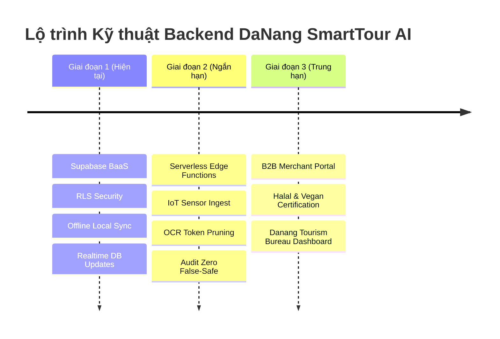

# DaNang SmartTour AI — Lộ Trình Phát Triển Backend (Backend Roadmap)

Tài liệu này định hình rõ ràng các giai đoạn phát triển Backend của dự án **DaNang SmartTour AI**, từ phiên bản Hackathon MVP hiện tại đến nền tảng du lịch số thông minh quy mô toàn thành phố.

---



---

## Giai đoạn 1: Supabase BaaS & Offline Cache (Hoàn thành & Vận hành)

### Mục tiêu:
Thiết lập nền móng lưu trữ dữ liệu an toàn, không tốn chi phí hạ tầng (Zero Server Cost) và phản hồi cực nhanh cho ứng dụng Flutter.

### Các hạng mục chính:
1. **PostgreSQL Database Schema**:
   - 8 bảng phân hệ đã chuẩn hóa tại `BE/DB/Danang_SmartTour_DB.sql`.
   - Lưu trữ 40 món ăn đặc sản Đà Nẵng bóc tách thành phần ngầm và 20 điểm tham quan/thể thao.
2. **Supabase Storage Bucket (`food-scans`)**:
   - Khởi tạo bucket để lưu trữ ảnh chụp món ăn của du khách (hỗ trợ phân tích lại, cải thiện mô hình nhận diện AI).
3. **Realtime Channels**:
   - Kích hoạt Supabase Realtime cho bảng `attractions`. Khi Cầu Rồng kích hoạt cờ `is_overloaded = true`, toàn bộ ứng dụng đang mở trên máy du khách sẽ nhận tín hiệu WebSocket và hiển thị lộ trình vòng tránh tự động.
4. **Local Fallback Sync**:
   - Đồng bộ dữ liệu định kỳ xuống SQLite/JSON cục bộ trên thiết bị để đảm bảo tính năng cứu sinh (Emergency Chef Card, cảnh báo dị ứng) vẫn hoạt động 100% khi mất mạng tại bán đảo Sơn Trà.

---

## Giai đoạn 2: Serverless Edge Functions & IoT Sensor Ingest (Mục tiêu tiếp theo)

### Mục tiêu:
Chuyển các tác vụ nặng, xác thực bảo mật và cổng kết nối cảm biến giao thông lên các hàm Serverless không máy chủ (Supabase Edge Functions chạy trên Deno/TypeScript hoặc FastAPI container).

### Các API Edge Services cần triển khai:

```
POST /api/v1/sensors/crowd-feed
POST /api/v1/safety/verify-ticket
POST /api/v1/vision/ocr-preprocess
GET  /api/v1/analytics/sdg-metrics
```

#### Chi tiết kỹ thuật:
1. **`POST /api/v1/sensors/crowd-feed` (IoT & Camera Ingest)**:
   - Tiếp nhận dữ liệu đếm người và lưu lượng phương tiện từ camera giao thông khu vực Cầu Rồng / Cầu Sông Hàn và trạm cảnh báo sóng biển cứu hộ bãi biển Mỹ Khê.
   - Khi lưu lượng vượt ngưỡng 350%, tự động cập nhật cờ `is_overloaded = true` trên Supabase Database và broadcast tới toàn bộ client qua Realtime Channel.
2. **`POST /api/v1/safety/verify-ticket` (Server-side Verification)**:
   - Thực thi nguyên tắc **Zero False-Safety** độc lập phía máy chủ: Ký số mã vé (SHA-256 HMAC) để đảm bảo không ai có thể làm giả hoặc chỉnh sửa nội dung thẻ dặn đầu bếp.
3. **`POST /api/v1/vision/ocr-preprocess` (Tesseract / PaddleOCR)**:
   - Tiền xử lý văn bản thực đơn nhà hàng (Menu OCR). Trích xuất danh sách tên món trước khi gọi vào Multimodal LLM, giúp tiết kiệm ~80% token thị giác và tăng tốc độ quét từ 4s xuống dưới 1s.
4. **`GET /api/v1/analytics/sdg-metrics`**:
   - Tổng hợp số phút kẹt xe đã giải tỏa (SDG 11), số lượt chuyển hướng tới các làng nghề truyền thống (SDG 8) và tỷ lệ 100% an toàn không rủi ro cho du khách (SDG 10).

---

## Giai đoạn 3: Cổng B2B Merchant Portal & Dashboard Trung Tâm Xúc Tiến Du Lịch

### Mục tiêu:
Mở rộng từ mô hình B2C (ứng dụng cho du khách) sang mô hình **B2B2C** kết nối chính quyền thành phố Đà Nẵng và các cơ sở kinh doanh du lịch bản địa.

### Các phân hệ chính:
1. **Cổng Web dành cho Chủ Quán & Nhà Hàng (Merchant Portal)**:
   - Cho phép các quán ăn địa phương (Mì Quảng Bà Mua, Bánh xèo Tôm nhảy Năm Hiền, Bún chả cá Hờn, v.v.) tự quản lý thông tin minh bạch:
     - Đăng ký loại dầu ăn sử dụng (dầu thực vật / dầu phộng / mỡ động vật).
     - Đăng ký nước dùng (có ninh xương heo hay không).
     - Tải lên chứng nhận Halal, chứng nhận An toàn Vệ sinh Thực phẩm.
     - Tiếp nhận đơn đặt món hoặc xem trước yêu cầu dinh dưỡng đặc biệt từ khách nước ngoài.
2. **Cổng Làng nghề Thủ công Truyền thống (SDG 8)**:
   - Hỗ trợ các nghệ nhân Làng đá Mỹ nghệ Non Nước, Làng chiếu Cẩm Nê đăng ký các workshop trải nghiệm điêu khắc đá, làm chiếu thủ công cho du khách được reroute từ khu vực đông đúc tới.
3. **Dashboard Trung tâm Xúc tiến Du lịch Đà Nẵng (Tourism Command Center)**:
   - Bản đồ nhiệt (Heatmap) thời gian thực hiển thị mật độ du khách quốc tế tại các điểm danh thắng (Cầu Rồng, Ngũ Hành Sơn, Chùa Linh Ứng, Bà Nà Hills).
   - Nút kích hoạt điều phối đám đông khẩn cấp (Emergency Reroute Dispatch) khi có sự kiện lễ hội lớn (Lễ hội Pháo hoa Quốc tế Đà Nẵng DIFF).

---

## 4. Tóm tắt Kế hoạch Hành động cho Developer

| Bước | Nhiệm vụ | Công nghệ | Độ ưu tiên |
|------|----------|-----------|------------|
| **1** | Kiểm tra Schema SQL & RLS policies trên Supabase | PostgreSQL / Supabase SQL | Hoàn thành |
| **2** | Tích hợp Supabase Realtime cho kẹt xe Cầu Rồng | Supabase Realtime WebSocket | Cao |
| **3** | Tạo Supabase Storage bucket `food-scans` | Supabase Storage API | Cao |
| **4** | Viết Edge Function xác thực chữ ký vé an toàn | Deno / TypeScript Edge Function | Trung bình |
| **5** | Khởi tạo khung Frontend cho B2B Merchant Portal | Flutter Web hoặc Next.js | Dài hạn |
